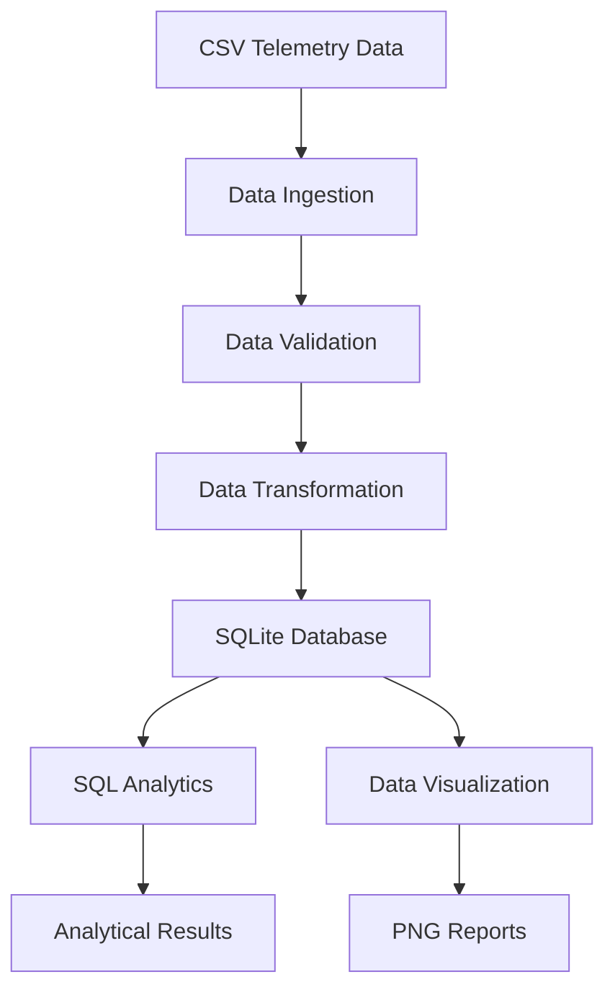

# SOLARWATCH — Solar Energy Telemetry & Monitoring Pipeline

A Python-based Data Engineering portfolio project for ingesting, validating, transforming, storing, and analyzing solar energy telemetry data.

SOLARWATCH demonstrates a complete small-scale ETL pipeline using Python, Pandas, SQLite, SQL, and Matplotlib.

## Project Overview

SOLARWATCH simulates a solar energy monitoring workflow. It processes telemetry records containing electrical measurements, solar generation, load consumption, battery state of charge, and temperature.

The pipeline converts raw CSV data into structured analytical data, stores the results in a SQLite database, executes SQL queries, and generates visual reports.

**Note:** The current dataset contains simulated telemetry. It is intended for demonstrating data engineering workflows and does not represent measurements from a real solar installation.

## Architecture



## Key Features

- **Data ingestion:** Load telemetry records from CSV using Pandas.
- **Data validation:** Check required columns, missing values, duplicate timestamps, battery SOC, solar power, load power, and battery voltage.
- **Data transformation:** Calculate battery power, energy per interval, and solar-to-load power balance.
- **Database storage:** Store processed telemetry in SQLite.
- **Idempotent loading:** Use SQLite UPSERT to insert new records and update existing records without creating duplicates.
- **SQL analytics:** Execute analytical queries directly against the database.
- **Data visualization:** Generate time-series charts using Matplotlib.
- **Automated testing:** Verify validation, transformation, and database operations using Python unittest.

## Technology Stack

| Technology | Purpose |
|---|---|
| Python | Pipeline implementation |
| Pandas | Data ingestion and manipulation |
| NumPy | Numerical computing dependency |
| SQLite | Structured data storage |
| SQL | Analytical queries |
| Matplotlib | Data visualization |
| unittest | Automated testing |
| Git & GitHub | Version control |

## Project Structure

```text
solarwatch-telemetry-pipeline/
│
├── data/
│   └── telemetry.csv
│
├── reports/
│   ├── solar_vs_load_power.png
│   ├── battery_soc.png
│   └── battery_power.png
│
├── sql/
│   └── queries.sql
│
├── tests/
│   ├── test_database.py
│   ├── test_transformation.py
│   └── test_validation.py
│
├── main.py
├── ingestion.py
├── validation.py
├── transformation.py
├── database.py
├── analytics.py
├── visualization.py
├── requirements.txt
├── README.md
├── LICENSE
└── .gitignore
```

The SQLite database is generated automatically at `data/solarwatch.db` when the pipeline runs. It is excluded from version control.

## Installation

### 1. Clone the repository

```bash
git clone https://github.com/TerezaVat/solarwatch-telemetry-pipeline.git
cd solarwatch-telemetry-pipeline
```

### 2. Create a virtual environment

```bash
python3 -m venv .venv
source .venv/bin/activate
```

### 3. Install dependencies

```bash
python3 -m pip install -r requirements.txt
```

## Running the Pipeline

Run the complete pipeline:

```bash
python3 main.py
```

The execution includes:

1. CSV data ingestion.
2. Data quality validation.
3. Energy calculations and transformations.
4. Energy summary generation.
5. SQLite database storage.
6. SQL analytical queries.
7. Visualization report generation.

## Data Processing

The pipeline calculates several derived metrics:

| Metric | Calculation |
|---|---|
| Battery power (W) | Voltage × Current |
| Solar energy (Wh) | Solar power × Interval duration |
| Load energy (Wh) | Load power × Interval duration |
| Battery energy (Wh) | Battery power × Interval duration |
| Solar-load balance (W) | Solar power − Load power |

The current dataset uses five-minute sampling intervals.

**Battery current convention:** Positive current represents battery discharge; negative current represents charging.

The first record has a zero-duration interval because there is no preceding timestamp from which to calculate elapsed time.

## SQL Analytics

The project includes SQL queries for:

- Total telemetry record count.
- Total solar energy generation and load consumption.
- Average, minimum, and maximum battery SOC.
- Average and maximum temperature.
- Distribution of solar power measurements.

SQL queries are stored in `sql/queries.sql` and executed through `analytics.py`.

## Visualization Reports

The pipeline automatically generates three charts in the `reports/` directory.

### Solar Generation vs Load Consumption

Compares solar power generation with load demand over time.

### Battery State of Charge

Shows changes in battery SOC during the observation period.

### Battery Charging and Discharging

Visualizes battery power, where positive values indicate discharge and negative values indicate charging.

## Sample Results

Results from the current simulated dataset (12 records):

| Metric | Result |
|---|---:|
| Telemetry records | 12 |
| Total solar energy | 33.33 Wh |
| Total load energy | 41.25 Wh |
| Net battery energy | 7.91 Wh discharged |
| Average battery SOC | 72.02% |
| Average temperature | 19.95 °C |
| Data validation errors | 0 |
| Data validation warnings | 0 |

These values demonstrate the pipeline's calculations on the sample dataset; they should not be interpreted as validated real-world system performance.

## Automated Testing

Run all unit tests:

```bash
python3 -m unittest discover -s tests -v
```

The test suite currently contains 15 tests covering:

- Data validation.
- Missing and invalid data.
- Duplicate timestamps.
- Energy transformation calculations.
- Sampling interval calculations.
- SQLite database creation and record storage.
- UPSERT behavior and duplicate prevention.
- Updating existing records.

**Current test status: 15 tests passed.**

## Limitations and Future Improvements

Potential development directions:

- Replace simulated telemetry with real sensor or IoT data.
- Introduce PostgreSQL as an alternative database backend.
- Implement scheduled ingestion and automated pipeline execution.
- Add more advanced data quality rules and anomaly detection.
- Develop a monitoring dashboard.
- Add configurable logging and error handling.
- Expand energy balance calculations and battery performance analytics.

## Project Status

**Portfolio MVP — implemented and tested.**

SOLARWATCH is an educational Data Engineering project focused on energy telemetry processing and analytics.

---

Created by [Tereza Vat](https://github.com/TerezaVat)
